<p align="center">
  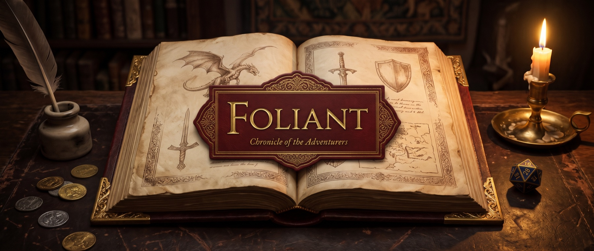
</p>

<p align="center">
  <b>A character manager for tabletop role-playing games.</b>
</p>

Foliant started with our own role-playing group. A few people joined who had never played before, and we
wanted to make it easier for them to get going: see their character clearly and use it without first reading
the whole rulebook. On top of that we were tired of paper sheets, lost notes and long chat threads about when
the next session would be. So I built Foliant.

Every player has their character on their own phone, the game master sees the whole group, and the rules are
loaded as packages, so you can use it for other systems as well. It doesn't replace anything at the table. We
still play with rulebooks and dice, Foliant just sits next to them.

<p align="center">
  <a href="LICENSE"></a>
  
  
  
  
</p>

<p align="center">
  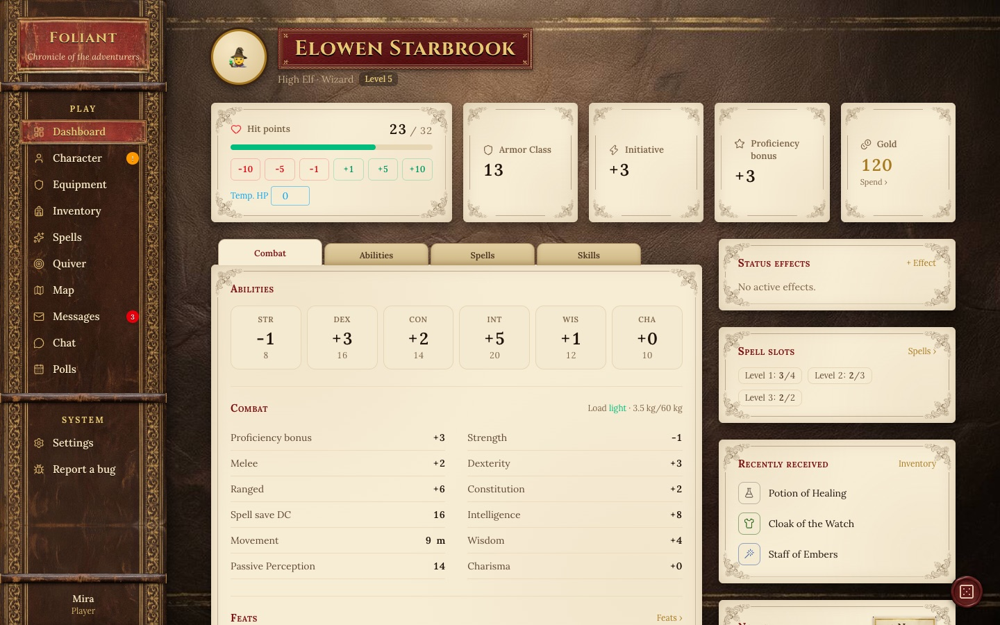
</p>

## What it does

- During a session: hit points with quick buttons, conditions, resources, rests and a 3D dice roller, all on
  one screen.
- Works on phones and can be installed as an app (PWA) with push notifications.
- The game master has an overview of the group, hands out gold and items (also unidentified ones), grants
  level-ups and manages monsters.
- Characters can have several classes. Each class counts with its own level, and each class that casts spells
  gets its own spellbook. Whether spell slots are separate or shared depends on the rule system.
- Between sessions there is a group chat, messages to one or more members (which can also be sent later), and
  polls for the next session date.
- Battle maps with fog of war. You upload your own map and the grid is detected automatically. Walls and doors
  block the line of sight, so players only see what their character can see.
- Rules, spells and feats are not part of the code but come in rule packages (`.foliant-rules`). Included are
  5e (SRD 5.1, with about 50 example feats) in English and German, and a very small example system to start
  your own.
- You host it yourself: one Docker container with SQLite.

## Screenshots

<table>
  <tr>
    <td width="50%">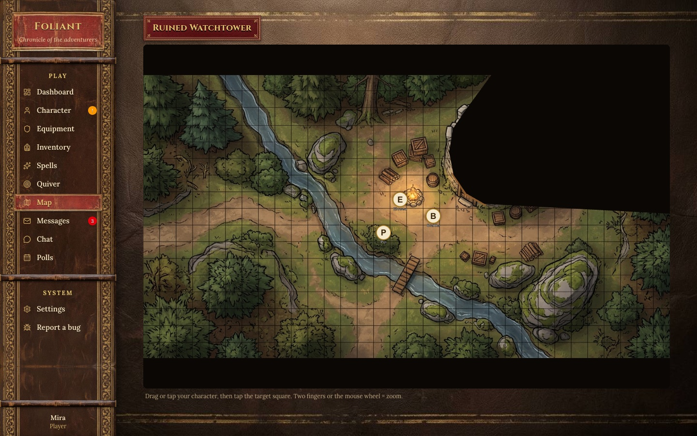<br><sub><b>Battle map, player view</b>: you only see what your character can see</sub></td>
    <td width="50%">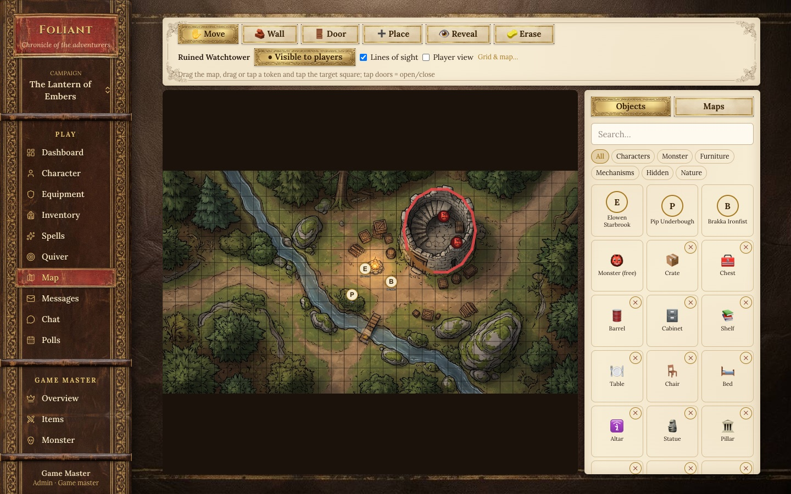<br><sub><b>Battle map, GM view</b>: walls, doors, hidden tokens and objects to place</sub></td>
  </tr>
  <tr>
    <td width="50%">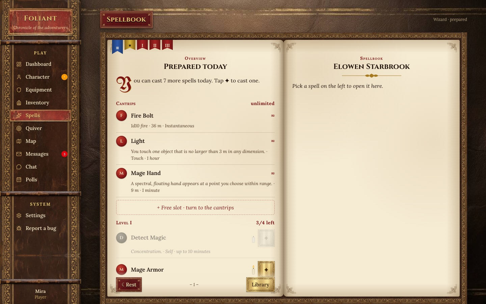<br><sub><b>Spellbook</b>: prepare spells, mark used slots, add spells from the library</sub></td>
    <td width="50%">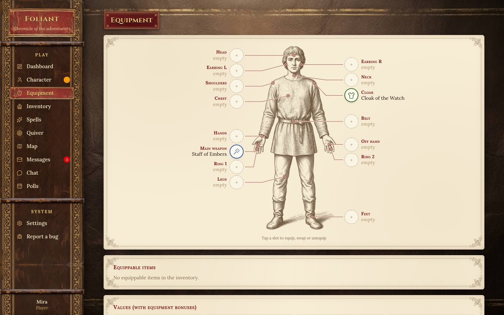<br><sub><b>Equipment</b>: tap a slot to equip an item, its bonuses are added to your values</sub></td>
  </tr>
  <tr>
    <td width="50%">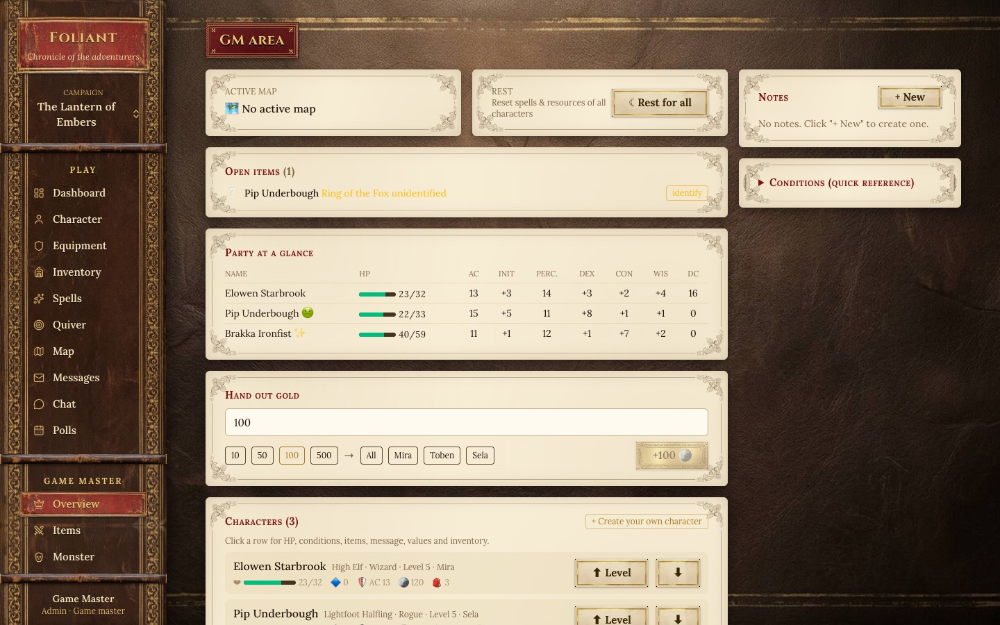<br><sub><b>GM overview</b>: the whole group with hit points, items, gold and rests</sub></td>
    <td width="50%">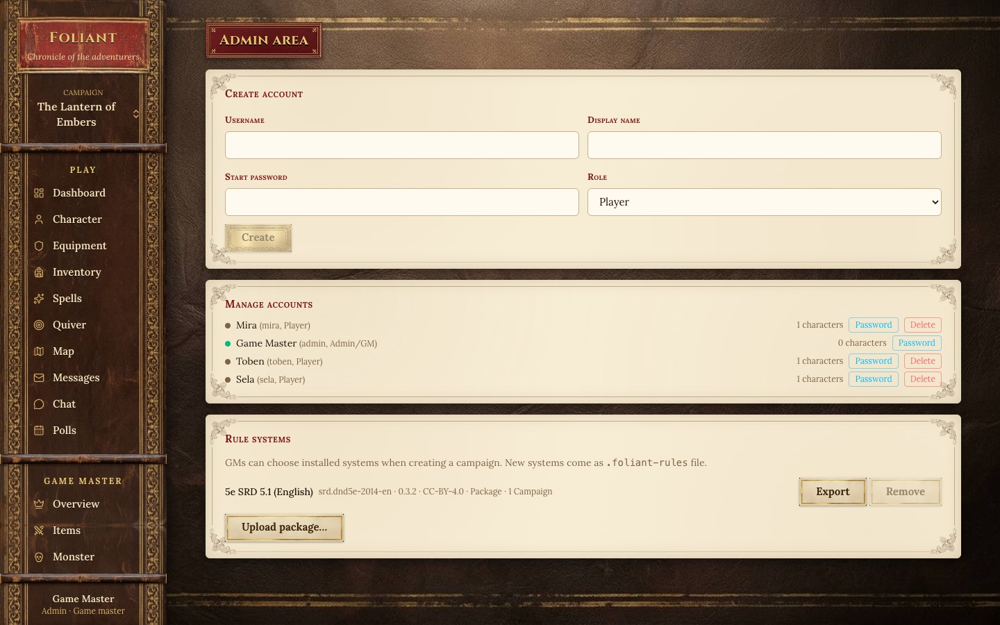<br><sub><b>Admin</b>: accounts and rule systems</sub></td>
  </tr>
  <tr>
    <td width="50%">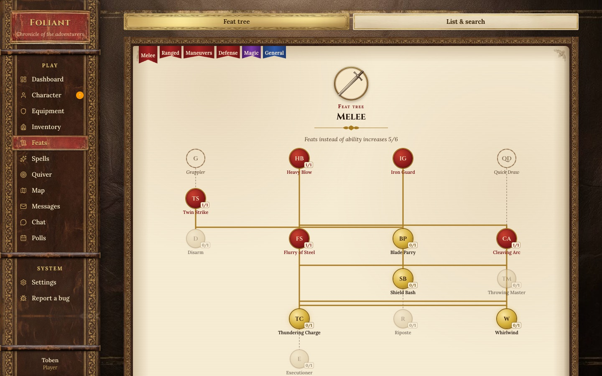<br><sub><b>Feat tree</b>: feats and their prerequisites, locked ones show what is missing</sub></td>
    <td width="50%">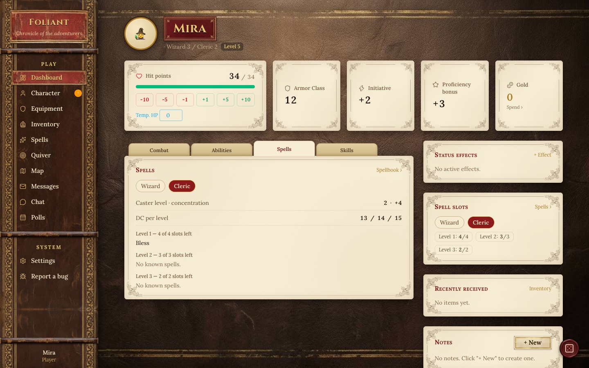<br><sub><b>Multiclassing</b>: a wizard and cleric with a spellbook for each class</sub></td>
  </tr>
</table>

<p align="center">
  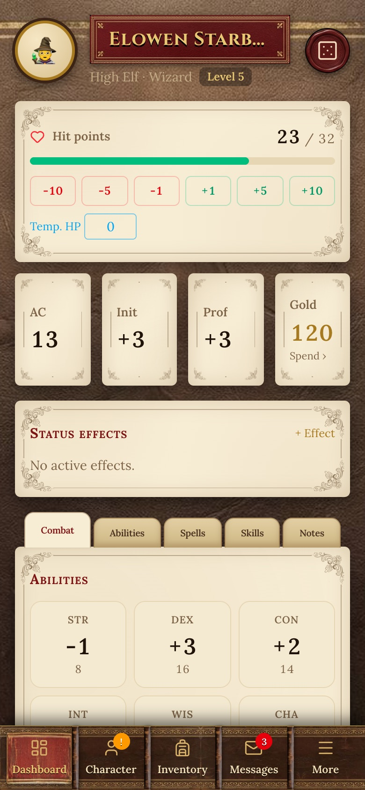&nbsp;&nbsp;
  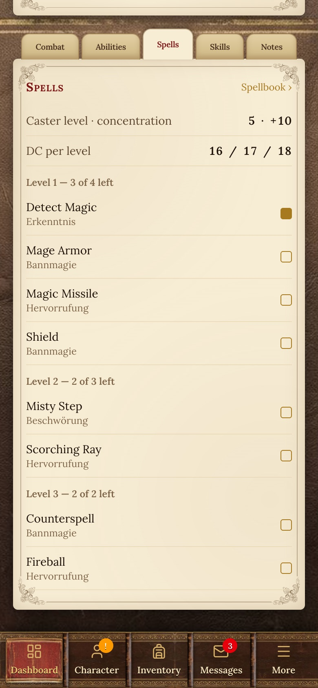&nbsp;&nbsp;
  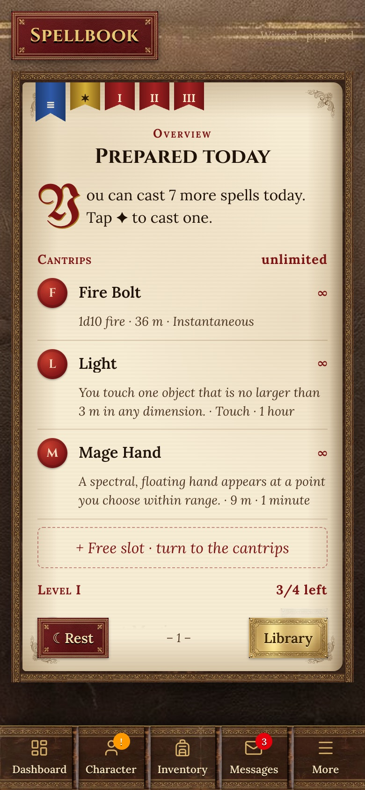
  <br><sub>On the phone: dashboard, today's spells and the spellbook</sub>
</p>

## Features

<table>
  <tr>
    <th align="left" width="33%">For players</th>
    <th align="left" width="33%">For game masters</th>
    <th align="left" width="33%">Rule systems</th>
  </tr>
  <tr valign="top">
    <td>
      <ul>
        <li>Character sheet that calculates AC, saves, attacks, skills and more</li>
        <li>Dashboard: HP, temporary HP, conditions, resources, rests</li>
        <li>Inventory and equipment with drag & drop</li>
        <li>Spellbook: prepared or known spells, slots, homebrew spells</li>
        <li>Feat tree with prerequisites, homebrew feats</li>
        <li>Battle map: move your own token, see only what your character sees</li>
        <li>Several classes per character, one spellbook per casting class</li>
        <li>Quiver for ammunition, 3D dice</li>
        <li>Group chat; messages to one, several or all members, also scheduled and marked as important</li>
        <li>Scheduling polls: propose dates, everyone answers yes / maybe / no, then pick the date</li>
      </ul>
    </td>
    <td>
      <ul>
        <li>Party overview with HP, conditions and values</li>
        <li>Grant level-ups, rest for everyone</li>
        <li>Hand out gold and items, also unidentified</li>
        <li>Custom items and monsters</li>
        <li>Battle maps: upload your own, automatic grid detection (or draw the grid), walls, doors, lines of sight, fog of war, hidden tokens</li>
        <li>Upload your own images: map objects, item icons, character portraits</li>
        <li>Several campaigns, players join via invite link</li>
        <li>Export and import a campaign as a <code>.foliant</code> file</li>
      </ul>
    </td>
    <td>
      <ul>
        <li>Rules are written as data: formulas, tables, classes, ancestries, choices</li>
        <li>Any number of abilities, multiclassing, separate or shared spell slots</li>
        <li>Each package contains test characters and is only installed if they pass</li>
        <li>Spell and feat lists in the package</li>
        <li>Included: 5e SRD 5.1 (English and German), Minimal-W6 template</li>
        <li><a href="docs/rule-packages.md">Guide: build your own package</a> and the <a href="docs/rule-package-reference.md">complete reference</a></li>
      </ul>
    </td>
  </tr>
</table>

## Quick start with Docker

You need [Docker](https://docs.docker.com/get-docker/) with Compose. One container serves the app and the
server and stores everything in SQLite. That is enough for several groups.

```bash
git clone https://github.com/Moony1993/foliant-rpg.git
cd foliant-rpg
echo "JWT_KEY=$(openssl rand -base64 48)" > .env     # signs the logins, keep it across restarts
docker compose up -d --build
docker compose logs foliant | grep "one-time password"   # first login as "admin"
```

Open <http://localhost:8080>, log in as `admin` with the one-time password and choose a new one.
To use a fixed start password instead, set `Seed__AdminPassword` under `environment` in
`docker-compose.yml`.

**Install a rule system.** None is installed yet. Zip a package, for example the English 5e one
(for German, use `srd5e` instead):

```bash
cd rule-packages/srd5e-en
zip -r ../srd5e-en.foliant-rules manifest.json rules.json layout.json spells.json feats.json tests
```

Upload it under **Admin → Rule systems → Upload package…**. Then create a campaign under **Campaigns**,
create an invite link under **Campaign** and send it to your players. New accounts can only be created
through such a link.

### Running it

| | |
|---|---|
| **Data** | The database and the push keys live in the volume `data`, uploaded images in `uploads`. Back up both. |
| **Updates** | `git pull && docker compose up -d --build`. Your data is kept. |
| **HTTPS** | Put a reverse proxy in front, e.g. `caddy reverse-proxy --from foliant.example.org --to localhost:8080`. Push notifications and installing the app need HTTPS. |
| **Language** | Each user picks English or German under **Settings**; the first visit follows the browser. |

## Development

You need the [.NET 10 SDK](https://dotnet.microsoft.com/download) and [Node.js 22](https://nodejs.org).

```bash
# Server (http://localhost:5099)
cd backend
ASPNETCORE_ENVIRONMENT=Development ASPNETCORE_URLS=http://localhost:5099 dotnet run

# App (http://localhost:5173), in a second terminal
cd frontend
npm install
npm run dev
```

In development mode the server creates the SQLite database itself, with the user `admin` and the password
`ChangeMe123!`, which you change at the first login. This password and a development signing key are set in
`appsettings.Development.json` and are only used there.

```bash
dotnet test                       # engine, rule packages, campaigns
cd frontend && npm run i18n:check # every UI text has an English translation
```

**Stack**: ASP.NET Core 10 (web API, SignalR for live updates, EF Core with SQLite or SQL Server) and
React 19 with TypeScript, Vite, Tailwind CSS and TanStack Query. The rule engine lives in
`backend/Domain/Rules/Engine/`, UI texts in `frontend/src/i18n/`.

## Contributing and your own versions

Bug fixes, new features and rule packages are welcome. Open an issue or a pull request at
<https://github.com/Moony1993/foliant-rpg>.

Not every feature works for every game system yet. If you are missing something, feel free to open an issue.
I work on Foliant in my spare time, so it may take a while until I get to it.

If you publish a modified version or run one as a service for others, the [AGPL v3.0](LICENSE) requires you
to make its complete source code available to its users, under the same license. **Please let me know before
you publish it** by opening an issue. I'd like to see what you made, link to it, and maybe take good changes
back into Foliant. This is a request, not a license condition.

## AI disclosure

I used generative AI while building this project: for code, documentation, translations, the texts in the
rule packages and all of the artwork. Foliant itself has no AI features and sends no data to AI services.

## License

The code is licensed under the [GNU AGPL v3.0](LICENSE): anyone who runs a modified version as a
service must publish their changes. The rule packages in `rule-packages/` carry their own license in
their `manifest.json` (5e SRD 5.1: CC BY 4.0, Minimal-W6: CC0).

**Images**: background, leather, buttons, ancestry figures, feat tree icons, the README banner and the battle
map in the screenshots are AI-generated (Nano Banana 2, DaVinci AI). The corner ornaments come from Ostell's type specimen book
(London 1848, public domain). The 3D dice use [`@3d-dice/dice-box`](https://github.com/3d-dice/dice-box)
(MIT); see `frontend/public/assets/dice-box/THIRD-PARTY-NOTICES.md`. The screenshots show demo data.
